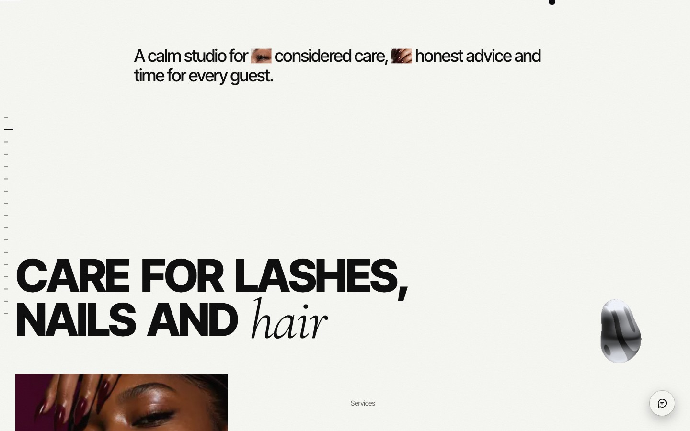
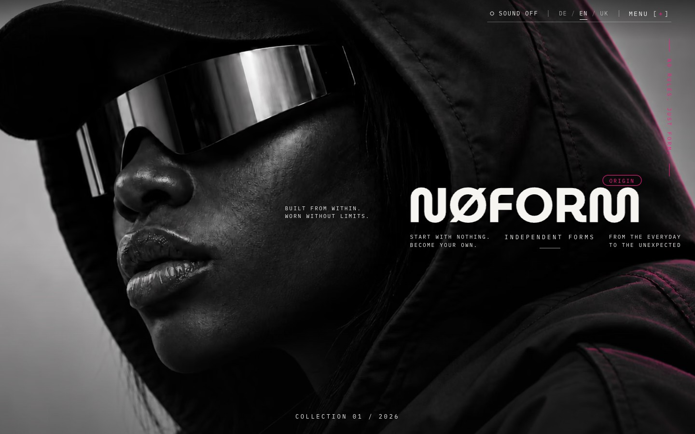
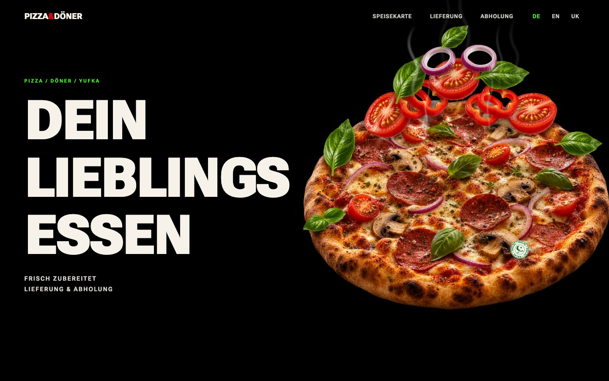
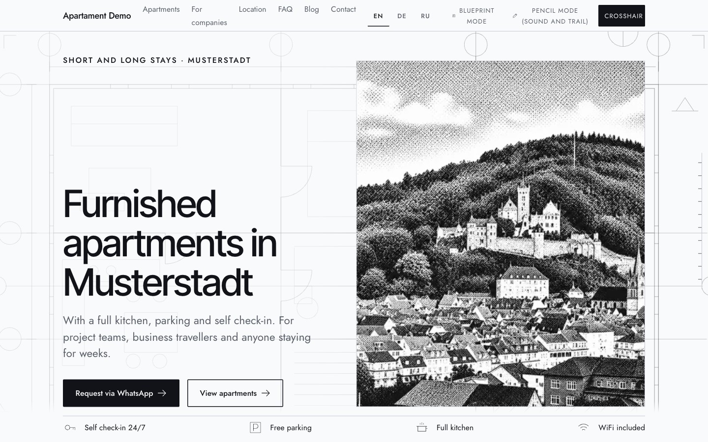
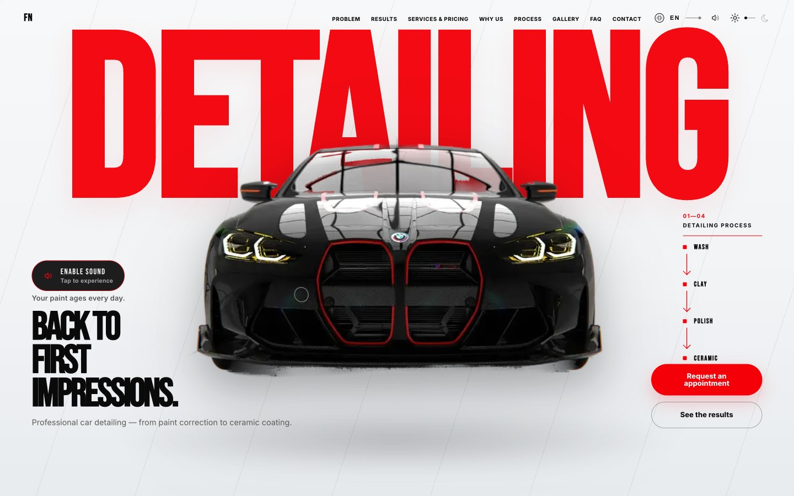
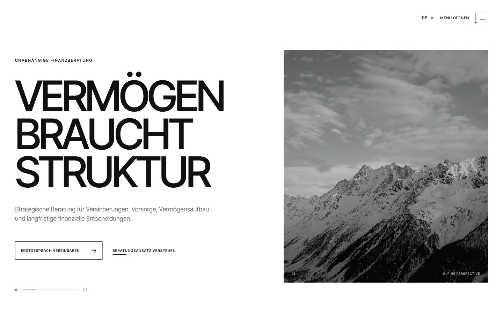

  

  
  
  

  <b>Design, build, deploy and SEO tracking, by one person.</b> 
  Germany · remote worldwide · on site in the Pforzheim area · open to relocation 
  🇬🇧 English · <a href="#deutsch">🇩🇪 Deutsch</a>

---

## 👋 About

I am a web developer who covers the whole path of a website: design, build, deployment and SEO tracking. I do not hand work over, I carry it to a measurable result. I build fast, search-friendly, multilingual sites with motion, and I work every day with AI tools such as Claude Code and GPT, with clear rules and a check on every step.

- 🎯 **Looking for:** developer roles (Next.js, React, TypeScript) in any format: on-site, hybrid or remote; employment, freelance or B2B
- 🗣️ **Languages:** Deutsch B1, Українська, Русский. English and Arabic copy with AI tools
- 🌍 **Sites in any language**, including right-to-left (Arabic)

## 🧰 Stack

  

Next.js App Router · React · strict TypeScript · CSS Modules · GSAP · ScrollTrigger · WebGL / Three.js · next-intl · Playwright · Vercel · Claude Code

## ✨ What I can do for your team

- Fluid, mobile-first layouts from 320px phones to ultra-wide screens
- Design tokens and component systems, accessible and semantic markup
- Animation with GSAP, ScrollTrigger and WebGL, with reduced-motion fallbacks
- Technical and on-page SEO, structured data, hreflang, sitemaps, Core Web Vitals
- Multilingual sites with next-intl, including full RTL
- Team workflow on GitHub: feature branches, pull requests, code review

## 🎨 Selected work

<table>
  <tr>
    <td width="50%" valign="top">
       
      <b><a href="https://beauty-studio-demo-nine.vercel.app">Beauty Studio</a></b> &nbsp;Next.js 16 · GSAP · next-intl · WebGL 
      A booking-focused website for a lash, nail and hair studio, built as a template: every colour, size, text, photo and contact detail lives in one config.
    </td>
    <td width="50%" valign="top">
       
      <b><a href="https://noform-drab.vercel.app">NØFORM</a></b> &nbsp;Next.js · GSAP · ScrollTrigger · Canvas 
      Fictional streetwear concept: scroll-driven scenes, sound and a strict mono type system.
    </td>
  </tr>
  <tr>
    <td width="50%" valign="top">
       
      <b><a href="https://pizza-doner-lieferservice.vercel.app">Pizza &amp; Döner</a></b> &nbsp;Next.js · GSAP · Three.js 
      Delivery website template with a scroll storyboard: toppings fly, a yufka rolls in, the box opens.
    </td>
    <td width="50%" valign="top">
       
      <b><a href="https://apartament-demo.vercel.app">Apartament Demo</a></b> &nbsp;Next.js 16 · next-intl 
      Furnished apartments demo with blueprint and pencil modes, FAQ and blog.
    </td>
  </tr>
  <tr>
    <td width="50%" valign="top">
       
      <b><a href="https://auto-detailing-website-tau.vercel.app">Detailing</a></b> &nbsp;Next.js 16 · GSAP · Lenis 
      Car detailing site: paint correction, ceramic coating, light and dark mode.
    </td>
    <td width="50%" valign="top">
       
      <b><a href="https://premium-consulting-template.vercel.app">Premium Consulting</a></b> &nbsp;Next.js · next-intl 
      Multilingual website template for independent financial advice.
    </td>
  </tr>
</table>

**More:** [Billyard](https://billyard-nu.vercel.app) · [Volodina Web Studio](https://volodina-web-studio-amber.vercel.app) · [this portfolio](https://volodina.de) · all projects with live links on [volodina.de/en/work](https://volodina.de/en/work)

## 🔒 Source code

The repositories are closed because the work was copied too often. **The source code is available on request:** write to me, tell me who you are and what you need, and I will show you the code in a call or send it to you. → [volodina.de/en/code](https://volodina.de/en/code)

## 📬 Contact

  
  

---

## 🇩🇪 Deutsch

**Full-Stack-Webentwicklerin aus Deutschland**: remote weltweit verfügbar, vor Ort im Raum Pforzheim, offen für einen Umzug.

Ich begleite eine Website über den ganzen Weg: Design, Entwicklung, Deployment und SEO-Tracking. Ich übergebe nichts, ich bringe es zu einem messbaren Ergebnis. Ich baue schnelle, suchmaschinenfreundliche, mehrsprachige Websites mit Motion und arbeite täglich mit KI-Tools wie Claude Code und GPT, mit klaren Regeln und einer Prüfung bei jedem Schritt.

- 🎯 **Ich suche:** Stellen als Entwicklerin (Next.js, React, TypeScript) in jedem Format: vor Ort, hybrid oder remote; Anstellung, Freelance oder B2B
- 🗣️ **Sprachen:** Deutsch B1, Українська, Русский. Englische und arabische Texte mit KI-Tools
- 🔒 **Quellcode:** Die Repositories sind geschlossen, weil die Arbeiten zu oft kopiert wurden. Auf Anfrage zeige ich den Code gern in einem Gespräch → [volodina.de/de/code](https://volodina.de/de/code)

[Portfolio](https://volodina.de/de) · [Für Recruiter](https://volodina.de/de/hire) · [Kontakt](https://volodina.de/de#contact)

---

© Christina Volodina. All rights reserved. Design, code and texts may not be copied without written permission.
